<div align="center">

<a href="https://edgarhovsepyan.github.io/">
  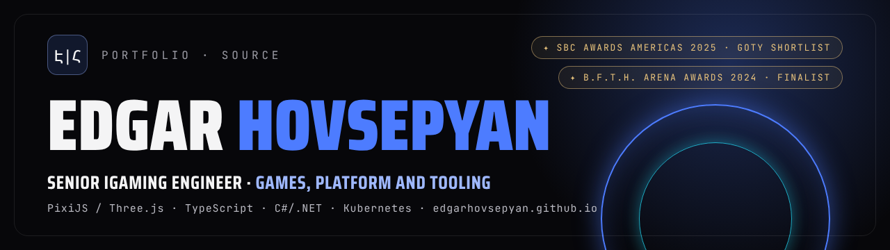
</a>

<br /><br />

<h1>Edgar&nbsp;Hovsepyan</h1>

<h3>Senior iGaming Engineer&nbsp;·&nbsp;Games, Platform and Tooling</h3>

<p>
  I build casino games and the services they run on. Seven years, 50+ titles,<br />
  from the reel stop to the random numbers behind it.<br />
  This repository is the source of my portfolio site.
</p>

<p>
  <a href="https://edgarhovsepyan.github.io/"></a>
  <a href="https://edgarhovsepyan.github.io/cv/Edgar_Hovsepyan_CV_ATS.pdf"></a>
  <a href="https://www.linkedin.com/in/edgar-hovsepyan-03044117b"></a>
  <a href="https://t.me/Dev_context"></a>
  <a href="mailto:edgarhovsepyan94@gmail.com"></a>
</p>

<p>
  
  
  
</p>

<br />

<a href="https://edgarhovsepyan.github.io/">
  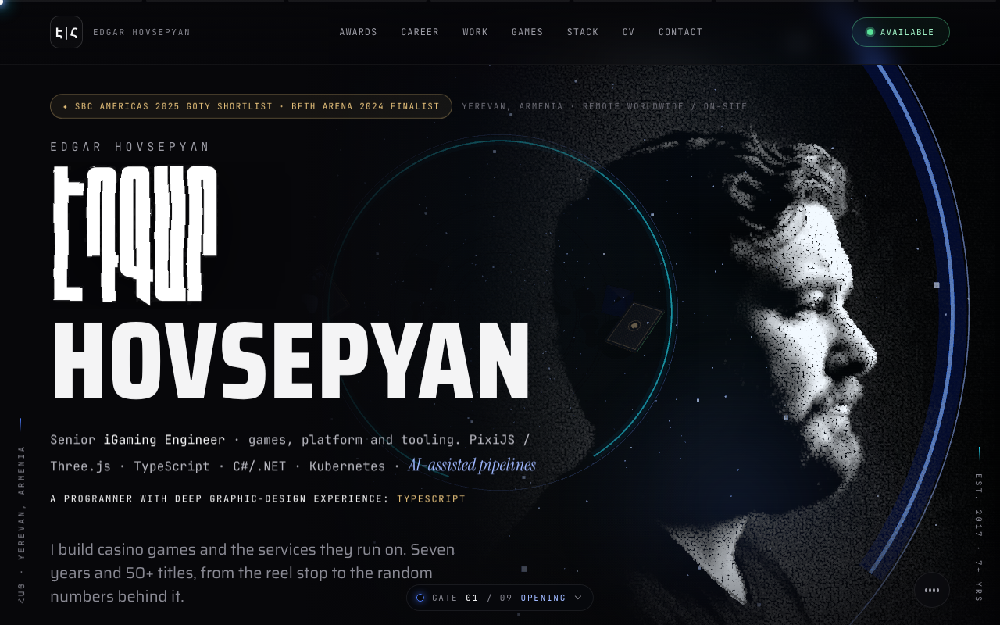
</a>

<sub>The hero. The portrait is drawn from tens of thousands of particles sampled from the photo. They part around the cursor, take a shockwave on click and blow away as you scroll.</sub>

<br /><br />

<a href="https://edgarhovsepyan.github.io/assets/showreel.mp4">
  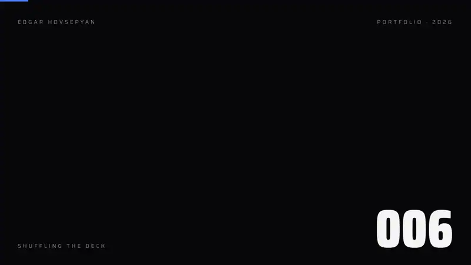
</a>

<sub>The showreel, 18 seconds. Built with Remotion from the same type, colours and screenshots as the site. Click for the full-quality video.</sub>

</div>

<br />

## What I do

| | |
|---|---|
| **Now** | Senior Software Engineer at **RedCore (RC Games)**. Games on the front (Plinko, Dice, Mines) and the platform under them: a random-number service for real-money play, bet history on ClickHouse, Keycloak sign-in, GitOps delivery on Kubernetes. |
| **2024 to 2026** | Senior Game Developer at **Pascal Gaming / BetConstruct**. PixiJS v8 and TypeScript across 14+ game verticals. Part of the team behind Non-Stop Roulette, shortlisted for Game of the Year at SBC Awards Americas 2025. |
| **2020 to 2024** | Team Lead at **Fastexverse / PandaMR**. Led 10 Unity developers plus front-end, back-end and QA on a metaverse platform, from prototype to production. |
| **Earlier** | Extra Studio (mini games and playable ads), Arakssys (Three.js), WebApricot (front-end). |

The full CV is in [`CV-2026.md`](CV-2026.md), and on the site as PDF and Word.

## The site, section by section

<table>
  <tr>
    <td width="50%">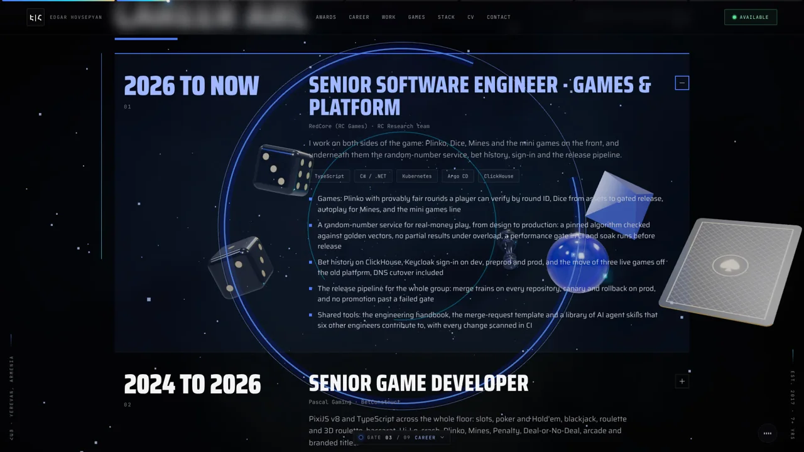<br /><sub><b>Career.</b> Rows open on click. Behind them, the corridor: one glowing gate per chapter, with cards, dice, chess pieces and coins between the gates.</sub></td>
    <td width="50%">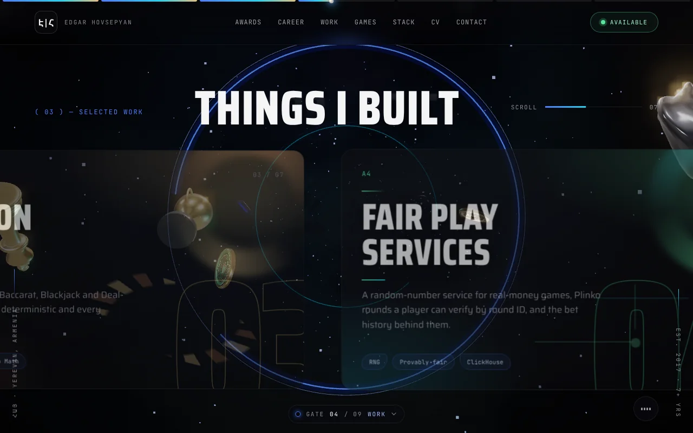<br /><sub><b>Things I built.</b> A pinned horizontal gallery driven by vertical scroll. The panel in the centre is in focus, the others step back.</sub></td>
  </tr>
  <tr>
    <td>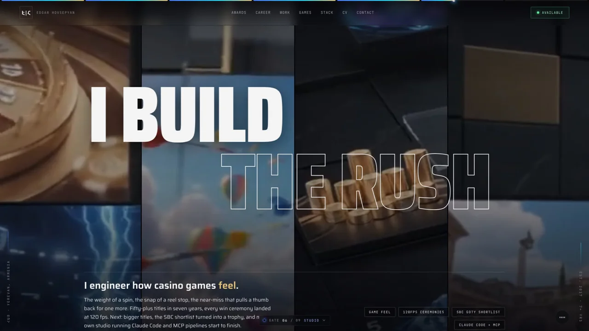<br /><sub><b>Studio.</b> A wall of reels behind an iris that opens as the section arrives. One line of the title is solid, the other is an outline the reels show through.</sub></td>
    <td>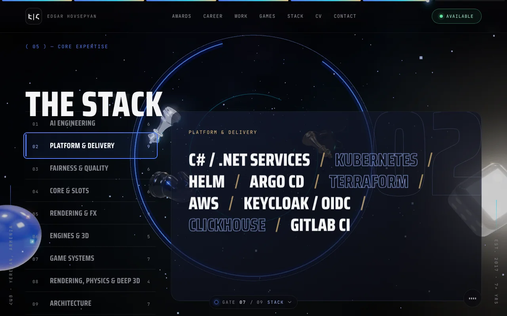<br /><sub><b>The stack.</b> A console: disciplines on the left as a real tab list, the selected one set as display type.</sub></td>
  </tr>
  <tr>
    <td>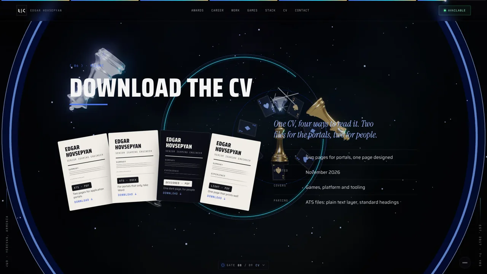<br /><sub><b>CV.</b> Four sheets dealt like a hand of cards: two files for application portals, two designed for people.</sub></td>
    <td>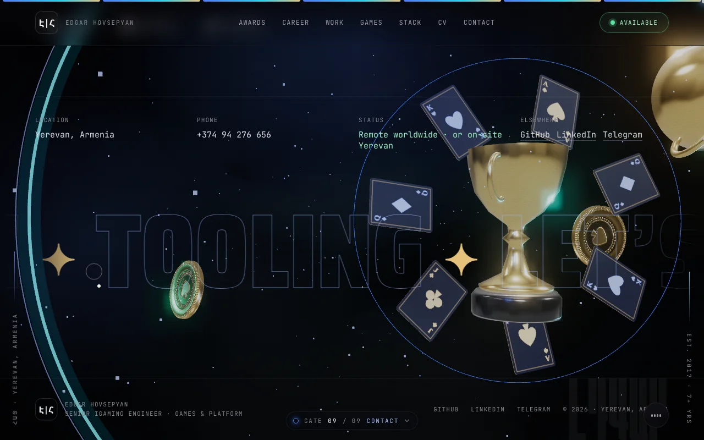<br /><sub><b>Finale.</b> Past the last gate, a ring of cards turns around a gold king with a diamond over its crown, behind the contact section.</sub></td>
  </tr>
</table>

<div align="center">
  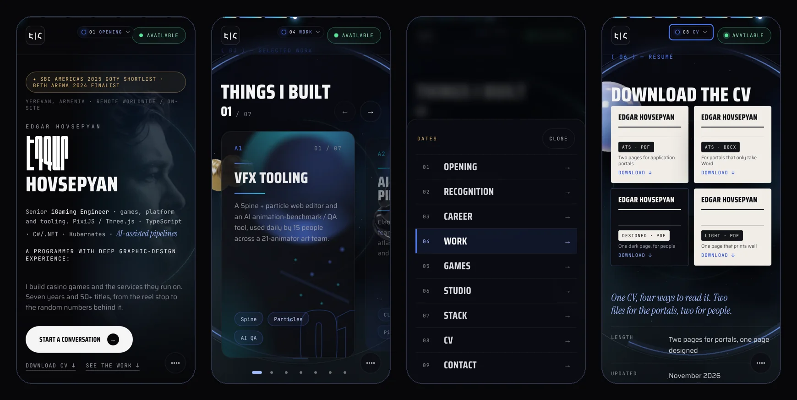
  <sub><b>On a phone.</b> The gallery becomes a swipe carousel, the gate strip in the header opens the section menu, the CV sheets become a grid, and the 3D pieces ride the edges of the screen so the text stays clear.</sub>
</div>

<div align="center">
  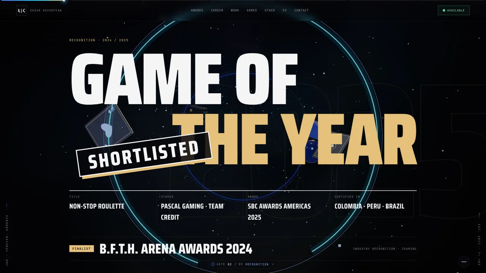
  <sub><b>Recognition.</b> The award set as a poster. The two lines close in on scroll and the result lands as a stamp.</sub>
</div>

## How it is built

**Rendering**

- **The corridor** (`src/three/createGateScene.ts`). A three.js scene behind the whole page. Scroll moves the camera through one gate per chapter; the pieces between gates follow one round of play: the deal, the roll, the thinking, the win, the machinery. Pieces drift from the cursor and take a kick from a click or tap. Desktop gets a bloom pass and real glass refraction; phones skip both.
- **The particle portrait** (`src/three/createPortraitParticles.ts`). Every lit pixel of the photo becomes a point with a depth taken from its brightness. One draw call; all the motion is in the vertex shader.
- **The nebula** (`src/components/ui/turbulent-flow.tsx`). A raymarched volumetric shader in raw WebGL, about 40 lines of GL plumbing and no library.
- three.js is a separate chunk that loads after first paint, so it never competes with the first screen. The chess pieces are CC0 geometry from Poly Haven, stripped to positions and normals and dressed in the site's own materials (see [`public/models/CREDITS.md`](public/models/CREDITS.md)). Cards, dice, coins and the trophy are built in code.

**Motion**

- Native scroll-driven CSS (`view-timeline`) runs the pinned gallery, the studio iris and the career spine. Browsers without it get a small scroll listener or a static layout.
- The pinned gallery is a sticky viewport, so it cannot go stale when something above it changes height.
- There is no animation library on the page.

**Behaviour that protects the experience**

- A frame-time watchdog halves the 3D resolution if frames run long, then stops the scene and leaves the CSS backdrop.
- Machines without a GPU never start the corridor.
- With reduced motion, the loader, the pinning, the particles and the scroll effects are off and everything is visible from the start.
- On narrow screens the 3D layer dims while you read and brightens while you scroll.

**Accessibility**

- axe reports no violations on the desktop and phone layouts (WCAG 2.2 AA plus best practice).
- The section menu is a native `<dialog>`. The stack is a real tab list with arrow keys. The phone gallery is a carousel with named buttons, markers and a polite status announcement.
- Text links have 44px hit areas on touch.

## Stack

| Layer | Choice |
|---|---|
| UI | React 19, TypeScript in strict mode, CSS Modules, no UI or CSS framework |
| 3D | three.js (lazy chunk), raw WebGL for the background shader |
| Motion | Scroll-driven CSS animations, CSS transitions, `requestAnimationFrame` hooks |
| Build | Vite 6 |
| Deploy | GitHub Actions to GitHub Pages on every push to `main` |

## Run it locally

Node 22.x. No environment variables.

```bash
git clone https://github.com/EdgarHovsepyan/EdgarHovsepyan.github.io.git
```

```bash
cd EdgarHovsepyan.github.io && npm install
```

```bash
npm run dev
```

| Script | What it does |
|---|---|
| `npm run dev` | Dev server with hot reload |
| `npm run build` | Type-check, then bundle to `dist/` |
| `npm run preview` | Serve the production build |
| `npm run typecheck` | Type-check only |

Add `?gl=force` to the URL to run the 3D scene on a machine without a GPU.

## Generated files

| What | Source | Command |
|---|---|---|
| ATS CV (`public/cv/*_ATS.pdf`, `.docx`) and `CV-2026.md` | `tools/build_cv.py` | `python3 tools/build_cv.py` |
| Designed and Light CV, one page each | `tools/cv-print-premium.html`, `tools/cv-print-branded.html` | `node tools/print_cv.cjs` |
| Social preview, README banner and hero screenshot | `tools/og-image.html`, `tools/banner.html` | `node tools/render_og.cjs` |
| `CONTENT.md`, the text mirror of `src/data` | `src/data/*.ts` | `node tools/sync_content.mjs` |
| The showreel (`public/assets/showreel.mp4`) | `reel/src/Reel.tsx`, a Remotion project with its own `package.json` | `cd reel && npm install && npm run render` |

The two `.cjs` scripts need the built site served on port 4173 (`npm run build`, then `npx vite preview`), so the templates can load the site fonts. [`LINKEDIN.md`](LINKEDIN.md) is a hand-kept draft of the profile text.

## Where things are

```text
.
├─ .github/
│  ├─ media/            banner, hero screenshot and section images for this README
│  └─ workflows/        deploy.yml: build and publish to GitHub Pages
├─ public/
│  ├─ assets/           portrait, game thumbnails, video reels and posters, social image
│  ├─ cv/               the four CV files
│  ├─ fonts/            self-hosted fonts
│  └─ models/           chess-piece geometry (CC0) and credits
├─ src/
│  ├─ components/
│  │  ├─ effects/       Background · GateScene · GateHud · Preloader · ScrollProgress
│  │  │                 CursorSpotlight · CustomCursor · Grain · SoundToggle · SurrealLayer
│  │  ├─ layout/        Nav · Footer · SideRails
│  │  ├─ sections/      Hero · StatsBand · Marquee · Profile · Awards · Timeline · Work
│  │  │                 Games · ExtraStudio · Expertise · Resume · Contact
│  │  └─ ui/            Reveal · Counter · Chip · SectionHeader · SkillCycler · DreamEye
│  │                    turbulent-flow
│  ├─ data/             all copy and lists: profile, experience, work, games, expertise
│  ├─ hooks/            useInView · useParallax · useScrollProgress · useSpotlight · useTilt
│  │                    useMagnetic · useScramble · useDraggableMarquee · useReducedMotion
│  ├─ three/            createGateScene · createPortraitParticles (lazy chunk)
│  └─ styles/           global tokens
├─ reel/                Remotion project for the 18 second showreel
├─ tools/               CV, image and content generators
├─ CONTENT.md           generated mirror of the site text
├─ CV-2026.md           generated CV source
└─ LINKEDIN.md          draft of the LinkedIn profile text
```

## Contact

Open to senior iGaming roles, remote or on site in Yerevan.

- Email: [edgarhovsepyan94@gmail.com](mailto:edgarhovsepyan94@gmail.com)
- LinkedIn: [edgar-hovsepyan-03044117b](https://www.linkedin.com/in/edgar-hovsepyan-03044117b)
- Telegram: [Dev_context](https://t.me/Dev_context)
- Site: [edgarhovsepyan.github.io](https://edgarhovsepyan.github.io/)

<div align="center">
<br />
<sub>Built in Yerevan with React 19, TypeScript, Vite and three.js.</sub>
</div>
